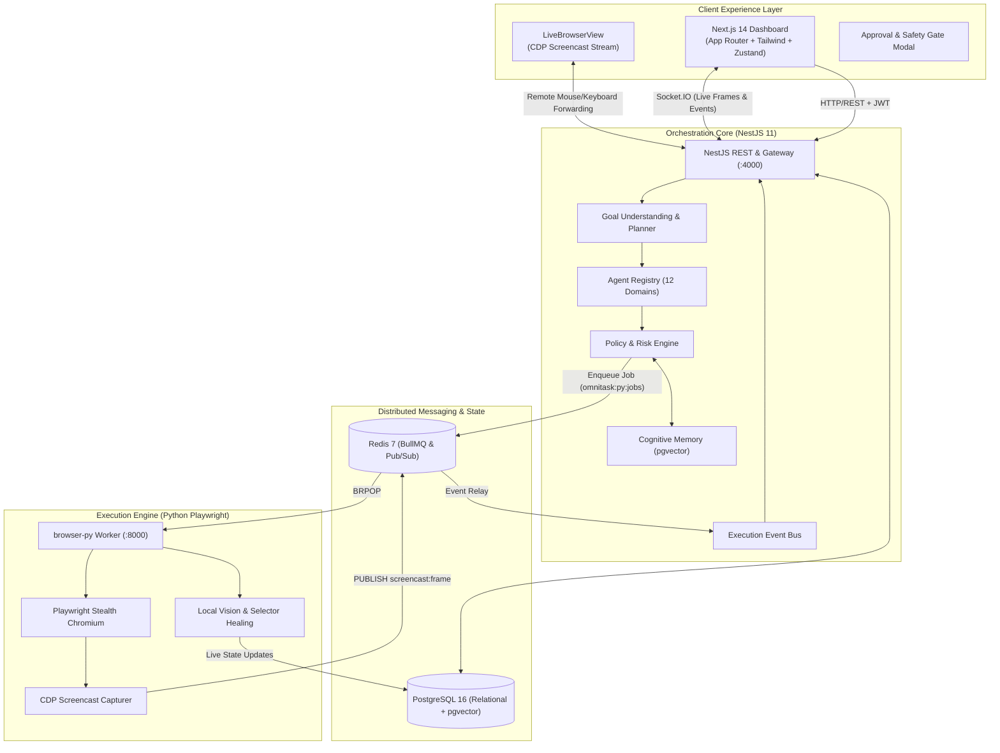

<div align="center">


# OmniTask AI
### *Autonomous Cognitive Browser Automation & Multi-Agent Execution Platform*

**Turn natural language goals into autonomous, verified web browser actions with real-time video streaming, cognitive self-healing, and human-in-the-loop safety gates.**

[](https://github.com/noupadasankar/omnitask-ai/actions/workflows/deploy.yml)
[](https://opensource.org/licenses/MIT)
[](https://www.typescriptlang.org/)
[](https://nestjs.com/)
[](https://nextjs.org/)
[](https://python.org/)
[](https://playwright.dev/)
[](https://www.docker.com/)

[Key Features](#-key-features) •
[Architecture](#-system-architecture) •
[Specialist Agents](#-specialist-agents) •
[Domain Agents](#-domain-agents-12) •
[Quick Start](#-quick-start) •
[Security & Guardrails](#-security--guardrails) •
[API & WebSocket](#-api--websocket-interfaces) •
[Production Deployment](#-production-deployment)

</div>

---

## 🌟 Executive Overview

**OmniTask AI** is an enterprise-grade autonomous browser automation platform designed to reliably bridge natural language intent with multi-step deterministic browser interactions. Instead of brittle selector-based scripts or black-box web scraping, OmniTask utilizes an ensemble of **specialized LLM agents**, a **Cognitive OS** with real-time drift detection, and a high-performance **Playwright automation engine** to navigate dynamic single-page web applications.

```
User Input:
  "Find the top 5 remote TypeScript software engineer jobs on LinkedIn and apply with my stored resume."

OmniTask Multi-Agent Execution:
  1. Goal Deconstruction: Extracts entities, filters, constraints, and risk tier (LOW/MEDIUM/HIGH/CRITICAL).
  2. Domain Routing: Dispatches context to Job Agent with persistent user profile & CV embeddings.
  3. Browser Session: Playwright launches stealth Chromium session with persistent user authentication.
  4. Cognitive Loop: Observes DOM tree + visual screenshots -> reasons next step -> executes interaction.
  5. Safety Gate: Detects final 'Submit Application' -> pauses session, requests human approval via dashboard.
  6. Verification: Verifier Agent scores outcome (≥70/100) and commits execution episode to vector memory.
```

---

## 🚀 Key Features

| Capability | Description | Technical Implementation |
|---|---|---|
| **Goal Planning** | Translates natural language into Directed Acyclic Execution Graphs (DAG). | Hierarchical LLM prompting with Zod schema validation |
| **Dual Automation Engine** | Distributed Python Playwright workers via Redis + inline NestJS execution. | BullMQ queue, Redis `BRPOP` loop, asyncpg, CDP streaming |
| **Live Browser Streaming** | Sub-second real-time viewport mirroring directly to the web dashboard. | Chrome DevTools Protocol (CDP) screencast via Socket.IO |
| **Human-in-the-Loop** | Autonomous execution with hard gates before high-risk actions. | Two-way WebSocket approval modals with live snapshot verification |
| **Self-Healing Automation** | Automatic selector fallback, anti-bot bypass, popup dismissal, and retry logic. | Multi-candidate CSS/XPath selector scoring & LLM visual recovery |
| **Cognitive Memory** | Long-term learning across user workflows, portal quirks, and preferences. | PostgreSQL 16 + `pgvector` embeddings (1536-dim) |
| **Stealth Browser Engine** | Persistent profiles preserving session cookies, bypasses automation flags. | Override `navigator.webdriver`, fake plugin arrays, realistic mouse physics |
| **Take Control Mode** | Direct user takeover of the remote browser session with mouse and key forwarding. | Real-time viewport input translation forwarded to Playwright |
| **Zero-Trust Security** | Vault encryption, double-CSRF protection, rate limiting, and PII masking. | AES-256-GCM, PBKDF2 (600k rounds), strict CSP & Helmet headers |

---

## 🏗 System Architecture



---

## 🤖 Specialist Agents

The core execution loop is governed by 6 specialized agents, each operating with distinct cognitive prompts and constraints:

1. **Orchestrator Agent**: Breaks goals into sub-tasks, assigns specialists, and coordinates parallel execution branches.
2. **Browser Agent**: Executes low-level Playwright primitives (clicks, typing, keyboard shortcuts, navigation, file uploads).
3. **Vision Agent**: Evaluates full-page visual screenshots to locate elements when DOM selectors change or obfuscate.
4. **Form Filler Agent**: Maps user memory profiles (resumes, addresses, preferences) cleanly onto complex multi-step forms.
5. **Data Extractor Agent**: Structures semi-structured web content into validated JSON schemas.
6. **Verifier Agent**: Post-execution evaluator that scores goal fulfillment (0–100) before marking any task as completed.

---

## 🌐 Domain Agents (12)

OmniTask AI provides 12 specialized domain engines equipped with custom site adapters, query patterns, and domain heuristics:

| Domain | Integrated Portals & Workflows |
|---|---|
| **Job Search** | LinkedIn Easy Apply, Naukri, Cutshort, Hirist, Instahyre, Indeed (resume parsing, filter matching) |
| **Food & Dining** | Swiggy, Zomato, DoorDash, UberEats, Grubhub, Yelp, OpenTable, Resy |
| **Shopping** | Amazon, Walmart, Flipkart, Target (price tracking, inventory monitoring, specification comparison) |
| **Travel** | Google Flights, Skyscanner, Booking.com, Airbnb (date-flexible flight & hotel discovery) |
| **Email** | Gmail, Outlook, generic IMAP/SMTP (inbox scanning, smart drafts, auto-replies) |
| **Social Media** | X (Twitter), LinkedIn, Reddit (post scheduling, trend research, engagement tracking) |
| **Calendar** | Google Calendar, Cal.com (scheduling, meeting links, collision resolution) |
| **Finance** | Invoice parsing, subscription audit, billing portal downloads, transaction tagging |
| **Research** | Google Scholar, arXiv, web synthesis, competitive analysis, structured Markdown compilation |
| **Booking** | Doctor appointments, vehicle service, government service slots, appointment reminders |
| **Media** | YouTube transcript extraction, podcast summarization, image asset downloading |
| **File Management** | PDF report generation, CSV data export, cloud drive folder synchronization |

---

## 🔒 Security & Guardrails

OmniTask AI is engineered with defense-in-depth safety:

- **Human-in-the-Loop Gates**: High-risk actions (e.g. monetary transactions, account deletion, profile submission) halt execution and broadcast an approval request with a live screenshot.
- **Form-Level Firewalls**: Automatic inspection prevents automated entry into fields identified as Credit Card Number, CVV, or SSN.
- **Double-CSRF Protection**: Backend issues cryptographically secure double-submit CSRF tokens on `/api/auth/csrf-token`.
- **Zero-Trust Credential Vault**: User site passwords and secrets are stored using AES-256-GCM encryption with PBKDF2 key derivation (600,000 iterations).
- **Session Privacy**: Chromium profiles are isolated per-user under `apps/browser-py/profiles/<user_id>` and never committed to source control.
- **Strict Network Egress**: Whitelist and domain safety policies prevent arbitrary navigation to dangerous or untrusted top-level domains.

---

## 📁 Repository Structure

```
omnitask-ai/                                 # Turborepo + pnpm monorepo root
├── apps/
│   ├── backend/                             # NestJS 11 Core API & Brain (Port 4000)
│   │   ├── prisma/
│   │   │   └── schema.prisma                # Relational schema (Users, Tasks, Memory, Executions)
│   │   └── src/
│   │       ├── agent/                       # Execution pipeline, cognitive OS & stages
│   │       ├── agent-registry/              # 12 Domain agent definitions & adapters
│   │       ├── auth/                        # JWT authentication, Google OAuth & RBAC
│   │       ├── common/                      # Circuit breaker, rate limiting, LLM client
│   │       ├── memory/                      # Vector episodic memory & consolidation
│   │       ├── queue/                       # BullMQ task processors
│   │       └── websocket/                   # Socket.IO gateway & event relays
│   │
│   ├── frontend/                            # Next.js 14 App Router UI (Port 3000)
│   │   └── src/
│   │       ├── app/                         # App Router pages (Dashboard, Tasks, Analytics, Health)
│   │       ├── components/                  # LiveBrowserView, 3D NeuralBrainCanvas, Modals
│   │       ├── hooks/                       # useAgentSession (WebSocket synchronization)
│   │       ├── services/                    # Axios API client with CSRF & refresh interceptors
│   │       └── store/                       # Zustand reactive stores
│   │
│   └── browser-py/                          # Python Playwright Automation Engine (Port 8000)
│       ├── main.py                          # Redis job consumer & FastAPI health/media server
│       ├── executor.py                      # Multi-step job execution & crash recovery
│       ├── streamer.py                      # CDP screencast video streamer
│       ├── db/                              # Direct asyncpg Postgres access for ported domains
│       └── agents/                          # Domain automation scripts (food, job, social, travel)
│
├── packages/
│   ├── config/                              # Shared ESLint, Prettier, and TypeScript configs
│   └── shared-types/                        # Canonical TypeScript models across all apps
│
├── infra/
│   ├── docker/                              # PostgreSQL, Redis & MinIO initialization configs
│   ├── monitoring/                          # Prometheus metrics & Grafana dashboards
│   └── nginx/                               # Reverse proxy & SSL production templates
│
├── docker-compose.yml                       # Development infrastructure (Postgres 16 + Redis 7)
├── docker-compose.prod.yml                  # Production stack (12 containerized services)
├── turbo.json                               # Turborepo build pipeline orchestration
└── pnpm-workspace.yaml                      # Monorepo package workspace configuration
```

---

## ⚡ Quick Start

### Prerequisites

Ensure the following runtimes and tools are installed on your machine:
- **Node.js**: `v20.x` or higher ([nodejs.org](https://nodejs.org))
- **pnpm**: `v8.x` or higher (`npm install -g pnpm`)
- **Python**: `v3.10` or higher ([python.org](https://python.org))
- **Docker**: Docker Desktop or Docker Engine with Docker Compose ([docker.com](https://www.docker.com))
- **LLM API Key**: [Groq Console](https://console.groq.com) (Recommended free tier) or OpenAI / OpenRouter

---

### Step 1: Clone Repository & Configure Environment

Clone the repository and create your local environment configuration:

```bash
# Clone the repository
git clone https://github.com/noupadasankar/omnitask-ai.git
cd omnitask-ai

# Copy the sample environment file
cp .env.example .env
```

Open `.env` and fill in your local values (no secrets are hardcoded in the codebase):

```env
# Database & Cache Configuration
DATABASE_URL="postgresql://<DB_USER>:<DB_PASSWORD>@localhost:5432/<DB_NAME>"
REDIS_URL="redis://localhost:6379"

# Authentication Secret (Generate with: openssl rand -hex 32)
JWT_SECRET="<YOUR_SECURE_JWT_SECRET>"

# LLM Provider Configuration
GROQ_API_KEY="<YOUR_GROQ_API_KEY>"
# OPENAI_API_KEY="<YOUR_OPTIONAL_OPENAI_KEY>"
# OPENROUTER_API_KEY="<YOUR_OPTIONAL_OPENROUTER_KEY>"
```

---

### Step 2: Start Core Infrastructure

Start PostgreSQL 16 and Redis 7 in detached Docker containers:

```bash
pnpm infra
```

*(To stop the background containers when finished: `pnpm infra:down`)*

---

### Step 3: Install Dependencies & Initialize Database

Install dependencies across all workspaces, download browser automation engines, and initialize the database schema:

```bash
# 1. Install Node workspace dependencies
pnpm install

# 2. Install Python engine dependencies
pip install -r apps/browser-py/requirements.txt

# 3. Install Playwright browser binaries
python -m playwright install chromium

# 4. Generate Prisma Client and push schema to database
pnpm db:push
```

---

### Step 4: Run the Full Stack

Launch all services (NestJS backend, Next.js frontend, and Python automation worker) concurrently:

```bash
pnpm stack
```

*(Alternatively, run services individually in dedicated terminals: `pnpm dev:backend`, `pnpm dev:frontend`, and `pnpm dev:browser-py`)*

---

### Step 5: Access the Platform

| Service | URL | Purpose |
|---|---|---|
| **Web Dashboard** | [http://localhost:3000](http://localhost:3000) | Interactive mission control & live browser streaming |
| **Backend API** | [http://localhost:4000/api](http://localhost:4000/api) | NestJS application endpoints |
| **Swagger API Docs** | [http://localhost:4000/docs](http://localhost:4000/docs) | Interactive Swagger OpenAPI specification |
| **Health Checks** | [http://localhost:4000/api/health](http://localhost:4000/api/health) | System, database, and Redis health probes |

---

## 📡 API & WebSocket Interfaces

### REST Endpoints Overview

- `POST /api/auth/register` — Register a new account
- `POST /api/auth/login` — Authenticate and receive access & refresh tokens
- `GET /api/auth/csrf-token` — Retrieve cryptographic double-submit CSRF cookie
- `POST /api/tasks` — Submit a natural language mission goal
- `GET /api/tasks/:id` — Inspect real-time execution plan and step status
- `POST /api/approvals/:id/decide` — Approve or reject a safety-gated browser action

### Real-time WebSocket Events (Socket.IO)

The frontend communicates with NestJS on namespace `/` via Socket.IO:

| Event Type | Direction | Payload Description |
|---|---|---|
| `execution:subscribe` | Client -> Server | Join the real-time event room for a `sessionId` |
| `screenshot:frame` | Server -> Client | JPEG viewport snapshot (base64) for live streaming |
| `execution:step` | Server -> Client | Current step execution progress, selector, and status |
| `approval:required` | Server -> Client | Triggers approval modal with risk score and action details |
| `approval:response` | Client -> Server | Submits user decision (`approved` / `rejected`) |
| `browser:interact` | Client -> Server | Take-control mouse click / keypress coordinate forwarding |

---

## 🚢 Production Deployment

OmniTask AI provides an out-of-the-box production configuration with 12 containerized services including Nginx reverse proxy, automated Let's Encrypt SSL, Prometheus metrics, and Grafana dashboards.

```bash
# Build and run the complete production environment
docker compose -f docker-compose.prod.yml up -d --build
```

### Production Checklist
- [x] Run `pnpm --filter backend prisma migrate deploy` for schema migration.
- [x] Configure high-entropy 64-hex-char keys for `JWT_SECRET`, `JWT_REFRESH_SECRET`, and `CSRF_SECRET`.
- [x] Set `VAULT_MASTER_KEY` for AES-256 credential encryption.
- [x] Enable SSL certificates via the included Certbot service.
- [x] Point Prometheus & Grafana to internal metric endpoints (`http://localhost:3001` for Grafana).

---

## 🛠 Quality Assurance & Testing

Run testing suites across all monorepo workspaces:

```bash
# Type check and build all packages
pnpm build

# Run linting across the monorepo
pnpm lint

# Execute backend Jest unit & integration tests
pnpm test

# Run Python browser-py pytest suite
pytest apps/browser-py/tests/
```

---

## 📄 License

Distributed under the **MIT License**. See [`LICENSE`](LICENSE) for more information.

---

<div align="center">

**[OmniTask AI](https://github.com/noupadasankar/omnitask-ai)** · Engineered for Autonomous, Safe, and Observable Web Automation.

</div>
